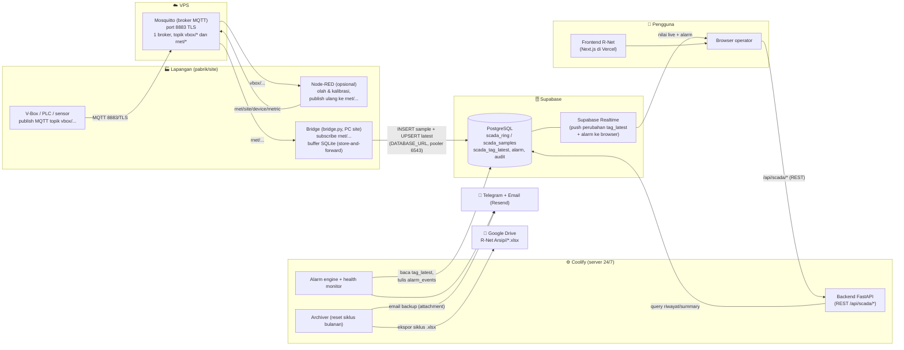
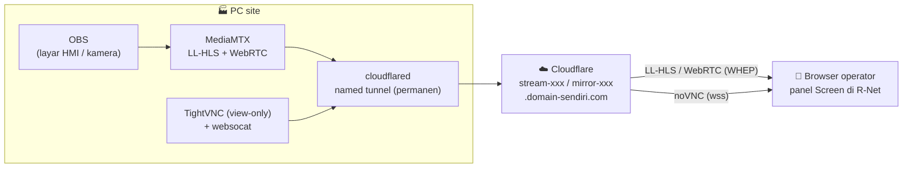

# Arsitektur R-Net (Cloud SCADA Remula)

Dokumen ini menjawab dua pertanyaan: **lewat mana data mengalir** dari sensor
sampai browser, dan **tabel apa saja yang menyimpannya**. Diagram memakai
Mermaid — langsung ter-render di GitHub.

## 1. Alur data ujung-ke-ujung

**Ringkas:** sensor publish ke **satu** broker Mosquitto di VPS (topik yang
membedakan, bukan broker). Bridge di PC site berlangganan topik `rnet/...` dan
menulis ke Supabase — dua lajur: `scada_tag_latest` (~1 detik, angka live) dan
`scada_ring`/`scada_samples` (per interval sampling, riwayat). Browser dapat
angka live lewat Supabase Realtime, dan riwayat/chart lewat backend FastAPI.
Alarm engine + health monitor jalan 24/7 di Coolify dan mengirim Telegram +
email. Archiver mengekspor tiap siklus (default 1 bulan) ke Google Drive dan
mengirimkannya lewat email (attachment Excel) sebelum data direset.

## 2. Jalur video / layar (terpisah dari jalur data)

Video **tidak lewat database sama sekali** — browser menarik stream langsung
dari MediaMTX di PC site melalui named tunnel Cloudflare. R-Net hanya
menyimpan alamat + kredensial read-only-nya di tabel `scada_streams`.

## 3. Peta tabel utama (`scada_*`)

```mermaid
erDiagram
    scada_sites ||--o{ scada_tags : "site_id (tag mqtt)"
    scada_sites ||--|| scada_bridge_status : "heartbeat per site"
    scada_sheets ||--o{ scada_tags : "sheet_id (baris workbench)"
    scada_sheets ||--o{ scada_workbench_columns : "kolom rumus/meta"
    scada_tags ||--o{ scada_samples : "riwayat (Simpan data ON)"
    scada_tags ||--o{ scada_ring : "ring 24 jam (Simpan data OFF)"
    scada_tags ||--|| scada_tag_latest : "nilai terakhir (~1 dtk)"
    scada_tags ||--o{ scada_alarm_events : "alarm high/low/silent"
    scada_tags ||--o{ scada_tag_archives : "ledger arsip per siklus"
    profiles ||--o{ scada_perspectives : "layout panel per user"
    profiles ||--o{ scada_alarm_events : "ack_by"
    profiles ||--o{ scada_audit_log : "actor (ubah konfigurasi)"
    profiles ||--o{ scada_data_access_log : "akses riwayat besar"
    scada_streams ||--o{ scada_channels : "channel kind=screen"

    scada_sites {
        uuid id PK
        string name
        string mqtt_host "broker VPS"
        int mqtt_port "8883 TLS"
        string mqtt_password "hanya dibaca bridge"
    }
    scada_tags {
        uuid id PK
        string source "simulator | mqtt"
        string label
        jsonb config "mqtt_topic, alarm_min/max, sampling_level, store_enabled"
    }
    scada_samples {
        uuid tag_id PK,FK
        timestamptz ts PK
        float value "historian - direset per siklus"
    }
    scada_ring {
        uuid tag_id PK,FK
        timestamptz ts PK
        float value "dipangkas lebih tua dari 24 jam"
    }
    scada_tag_latest {
        uuid tag_id PK,FK
        timestamptz ts
        float value "lajur live - Supabase Realtime"
    }
    scada_alarm_events {
        uuid id PK
        string kind "high | low | silent | expiring"
        timestamptz triggered_at
        timestamptz cleared_at "NULL = masih aktif"
        timestamptz notified_at "klaim kirim Telegram/email"
    }
    scada_bridge_status {
        uuid site_id PK,FK
        bool connected
        timestamptz updated_at "detak jantung ~15 dtk"
    }
    scada_audit_log {
        bigint id PK
        string action "create | update | delete"
        string target_type "tag | site | stream | settings"
        jsonb changes "diff lama-baru, rahasia diredaksi"
    }
    scada_data_access_log {
        bigint id PK
        string kind "recent | samples | history"
        text tag_labels
        int row_count "bahan alert ambang harian"
    }
```

Catatan baca:

- **`scada_samples_all`** (tidak digambar) = VIEW gabungan `scada_ring ∪
  scada_samples`. Semua endpoint baca (recent/samples/history/summary/
  sparklines) lewat view ini, jadi tak perlu tahu sebuah tag ring atau
  historian. Penulis (bridge/archiver) selalu ke tabel fisiknya.
- **`scada_alarm_settings`** dan **`scada_settings`** (tidak digambar) adalah
  tabel satu-baris (id=1): yang pertama saklar notifikasi (email/Telegram,
  penerima, cooldown), yang kedua knob global (durasi level sampling, jendela
  ring, panjang siklus historian).
- **`scada_perspectives`** menyimpan layout panel per user (JSONB);
  **`scada_channels`** memetakan nomor channel → sumber (screen/chart/gauge/…).
- Kolom rahasia (`mqtt_password`, `read_pass`, `secret`) tidak pernah keluar
  lewat API browser dan diredaksi di audit log.

## 4. Siapa menulis apa (satu database, banyak penulis)

| Penulis | Jalan masuk | Tabel yang ditulis |
|---|---|---|
| Bridge (PC site) | `DATABASE_URL` pooler 6543 | `scada_ring`, `scada_samples`, `scada_tag_latest`, `scada_bridge_status` |
| Backend FastAPI (Coolify) | `DATABASE_URL` | semua tabel konfigurasi + `scada_alarm_events`, `scada_audit_log`, `scada_data_access_log` |
| Archiver (di dalam backend) | `DATABASE_URL` | `scada_tag_archives`, hapus+reset `scada_samples` |
| Browser | HANYA lewat REST backend / Realtime (baca) | — (tidak pernah menulis langsung) |
