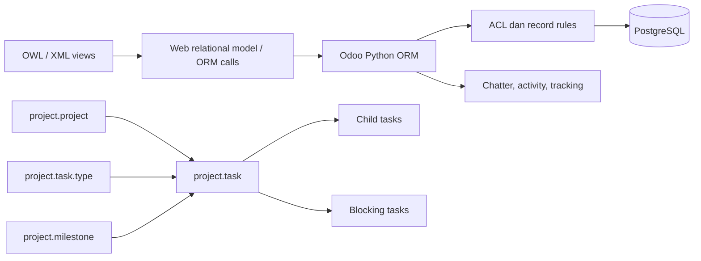

# Analisis Odoo Project untuk Rein

Tanggal: 5 November 2026. Status: semua tahap adaptasi yang direncanakan sudah diimplementasikan dan tersedia pada preview lokal.

Lihat [FINAL-DELIVERY.md](FINAL-DELIVERY.md) untuk cakupan akhir, verifikasi, migrasi dan pengaktifan. [IMPLEMENTATION.md](IMPLEMENTATION.md) mencatat tahap pertama. Analisis di bawah merekam kondisi awal sebelum implementasi.

## Hasil utama

Perluas Workspace Rein sebagai fondasi fitur Project. Odoo Project bergantung pada ORM, sistem view, autentikasi, mail, dan modul internal Odoo; modulnya tidak dapat langsung dipasang pada FastAPI/Next.js. Implementasi yang disarankan adalah perilaku setara dengan model dan komponen Rein.

Referensi dipatok ke **Odoo Community branch 19.0**, commit `edceef7991b19796b21debf9819f532a33778f87`. Branch ini dipilih sebagai baseline versi yang eksplisit, bukan klaim versi terbaru. Checkout terbatas berada di `.research/odoo`; ini bukan instalasi server Odoo atau salinan seluruh ERP.

## Plugin dan metode

| Komponen | Status dan penggunaan |
|---|---|
| ECC 2.2.3 (`ecc@ecc`) | Sudah terpasang dan enabled sebelum pekerjaan ini; digunakan melalui skill Codebase Onboarding untuk inventaris, arsitektur, alur data dan pemetaan Rein |
| REA 6.8.0 (`rea@rea`) | Dipasang melalui pengelola plugin Codex dari marketplace resmi; tools REA yang sudah tersedia dalam sesi digunakan untuk analisis statis JavaScript Project |
| Sumber ECC | `.research/ecc`, commit `b38be6a7f6350964d59328b52f0624e1d1d552d1` |
| Sumber REA | `.research/rea`, commit `fe677f6cf9853fb12490dfb8ef23ccae3a551049` |

Pengelola plugin Codex menyimpan instalasi pada profil pengguna, bukan sebagai dependensi aplikasi. Konfigurasi proyek mengaktifkan kedua plugin; versi dan sumber dicatat dalam `sources.json`. Tidak dibuat registrasi MCP kedua atau salinan skill yang menduplikasi plugin ECC.

Verifikasi pemasangan dan perbaikan paket dicatat di [INSTALLATION.md](INSTALLATION.md). REA berhasil menjawab handshake MCP sebagai versi 6.8.0 dengan 229 tools. Node lokal 24.13.0 masih di bawah persyaratan resmi paket; keberhasilan pemeriksaan ini bukan jaminan seluruh provider berjalan pada versi Node tersebut.

Skill REA mengutamakan analisis artefak/runtime dan menyarankan alat repository biasa untuk sumber lengkap. Karena pengguna secara eksplisit meminta penggunaan keduanya, REA dipakai secara terbatas untuk tiga sumber JavaScript yang relevan. Python, XML, ACL dan perbandingan arsitektur diperiksa langsung mengikuti workflow ECC. Label authority otomatis REA `shipped-artifact` tidak berarti server Odoo dijalankan: input yang dianalisis adalah checkout sumber.

## Arsitektur Odoo yang relevan

Pintu masuk modul adalah [`addons/project/__manifest__.py`](https://github.com/odoo/odoo/blob/edceef7991b19796b21debf9819f532a33778f87/addons/project/__manifest__.py). Dependensi langsung: analytic, base_setup, mail, portal, rating, resource, web, web_tour, digest. Manifest juga mendaftarkan security, XML views, laporan, wizard, serta aset frontend.

| Model / berkas | Peran |
|---|---|
| `models/project_project.py` | Identitas proyek, customer, manager, visibility, stages, template, opsi dependensi/milestone/recurrence |
| `models/project_task.py` | Task, banyak assignee, prioritas, deadline, parent/child, dependencies, milestone, recurrence, state dan tracking |
| `models/project_task_type.py` | Stage terurut, dapat dibagi antarproyek, fold, template email/rating dan penanda task stale |
| `models/project_milestone.py` | Target proyek, deadline, reached date, jumlah task dan closed task |
| `models/project_update.py` | Pembaruan kesehatan/progres proyek |
| `models/project_task_recurrence.py` | Jadwal pengulangan task |
| `views/project_task_views.xml` | Form, Kanban, list, kalender, pivot, graph dan activity |
| `security/project_security.xml` + `ir.model.access.csv` | Hak model dan pembatasan record, termasuk perusahaan dan portal |
| `static/src/views/project_task_kanban/` | Model/controller/renderer/record Kanban |
| `static/src/components/project_task_state_selection/` | Pilihan status dan representasi visualnya |

### Tahap kerja berbeda dari status tugas

Odoo menyimpan `stage_id` dan `state` secara terpisah. Stage adalah kolom proses yang dapat dikonfigurasi. State mencakup In Progress, Changes Requested, Approved, Done, Cancelled, dan Waiting. `Approved` tidak sama dengan `Done`; `is_closed` berasal dari Done atau Cancelled. Sumber: [`project_task.py`](https://github.com/odoo/odoo/blob/edceef7991b19796b21debf9819f532a33778f87/addons/project/models/project_task.py), field sekitar baris 161–175 dan `CLOSED_STATES` sekitar baris 84.

Dependency terbuka dapat membuat task menjadi Waiting; ketika penghalang selesai, task terbuka kembali menjadi In Progress melalui `_compute_state`. Perubahan stage juga terlibat dalam komputasi state. Saat mengadaptasi, tentukan aturan reset status secara eksplisit agar pemindahan kolom tidak membatalkan persetujuan Rein tanpa sengaja.

### Contoh alur Kanban

1. XML view memilih model dan komponen Kanban.
2. `ProjectTaskKanbanModel._webReadGroup` menambahkan konteks `project_kanban` lalu meneruskan pengelompokan ke relational model.
3. Saat membuka subtasks, `ProjectTaskRecord.toggleSubtasksList` memuat `child_ids` dengan nama, proyek, state, assignee dan urutan.
4. Penghapusan kelompok stage memanggil `unlink_wizard` dan menunggu hasil dialog. Ini menunjukkan penghapusan stage memerlukan penanganan task di dalamnya.
5. Komponen state selection menyediakan ikon/warna, pilihan status dan shortcut; validitas mutasi tetap perlu dijamin backend.

Sumber: [`project_task_kanban_model.js`](https://github.com/odoo/odoo/blob/edceef7991b19796b21debf9819f532a33778f87/addons/project/static/src/views/project_task_kanban/project_task_kanban_model.js), [`project_task_state_selection.js`](https://github.com/odoo/odoo/blob/edceef7991b19796b21debf9819f532a33778f87/addons/project/static/src/components/project_task_state_selection/project_task_state_selection.js).

### Hak akses

Odoo menggabungkan ACL model dengan record rules. Ada akses user/manager, visibility proyek, follower, assignment, aturan portal dan multi-company. Meniru tombol atau menu saja tidak mereplikasi pembatasan datanya. Implementasi Rein harus menguji setiap endpoint berdasarkan identitas pengguna dan proyek yang dapat diakses.

## Fondasi Rein yang sudah ada

- Backend: FastAPI, Pydantic 2, SQLAlchemy 2 async; PostgreSQL dan Alembic.
- Frontend: Next.js 16.2.6, React 19, Zustand dan dnd-kit.
- `db/models/workspace.py`: template → phase template → task template; aktual proyek → fase → task → completion.
- `backend/app/routers/workspace.py`: API proyek, fase, tugas, ringkasan, timeline dan alur WO.
- `frontend/src/features/workspace/`: daftar proyek, Kanban, kalender, drawer WO dan modal laporan.
- `db/models/project.py` / `/api/projects`: proyek dokumen DCC (`clients_projects`), berbeda dari `workspace_projects`. Jangan menyatukannya berdasarkan nama saja.
- Permission workspace dan filtering berdasarkan manager/assignment sudah ada. Pemeriksaannya perlu dibuat konsisten di semua mutasi tambahan.

Alur saat ini: komponen Workspace → API client `frontend/src/lib/api/workspace.ts` → FastAPI router → permission/assignment checks → model SQLAlchemy → database. Laporan WO memindahkan task ke `pending_review`; endpoint review menyetujui ke `done` atau mengembalikan ke `in_progress` dengan catatan revisi.

## Peta fitur dan gap

| Fitur Odoo | Rein saat ini | Adaptasi yang disarankan |
|---|---|---|
| Project + customer + manager | Ada; customer Workspace masih teks | Pertimbangkan FK ke master client tanpa menghapus teks historis |
| Template proyek/tugas | Ada berbasis fase | Pertahankan; perluas agar template bisa menyimpan stage/dependency |
| Kanban/list/calendar | Ada | Tambah stage dinamis dan persist urutan drag |
| Stage terpisah dari state | Kolom WO memakai status tetap | Tambah `stage_id`; pertahankan status review sebagai dimensi lain |
| Multi-assignee | Satu `assigned_to` | Tabel task assignee, backfill dari nilai lama |
| Subtasks | Belum terlihat pada model Workspace | `parent_task_id`, cegah siklus dan aturan proyek/phase |
| Task dependencies | Belum terlihat | Relasi predecessor/successor, cegah siklus, definisikan blocked |
| Milestones | Belum terlihat; fase bukan milestone | Model milestone terpisah dan hubungan task |
| Tags dan prioritas | Belum terlihat pada task Workspace | Tag relasional dan prioritas tervalidasi |
| Activity/chatter/tracking | Completion dan review notes | Riwayat perubahan dan komentar/lampiran dengan izin |
| Recurring tasks | Belum terlihat | Scheduler idempoten, aturan tanggal dan snapshot template |
| Timesheet | Estimasi hari; bukan pencatatan jam | Adaptasi terpisah berdasarkan `hr_timesheet` |
| Sales → project/task | Belum diperiksa menyeluruh | Integrasi berikutnya; `sale_project` memiliki dependensi tambahan |
| Customer portal | Belum terlihat pada Workspace | Tahap lanjutan dengan izin record khusus |
| Pivot/graph/burndown | Ringkasan dasar ada | Agregasi server setelah model status stabil |
| Gantt | Tidak ada pada view mode Project Community yang diperiksa | Perlakukan sebagai pengembangan terpisah, jangan janjikan hasil clone repo ini |

`hr_timesheet` dan `sale_project` adalah add-on terpisah, bukan seluruhnya isi `project`. Checkout mencakup manifest dan sumbernya untuk konteks; dependensi transitif belum seluruhnya diunduh atau dianalisis.

## Temuan yang perlu ditangani sebelum memperluas fitur

1. `update_task` di `backend/app/routers/workspace.py` menerima `body.status` dan langsung mengubah enum setelah izin umum. Ini memungkinkan jalur perubahan status yang tidak melalui endpoint review. Perlu state machine server yang sama untuk semua mutasi status.
2. Endpoint lama `/tasks/{id}/complete` langsung menyetel `done` dengan permission `workspace:complete_task`. Putuskan jalur kompatibilitas agar tidak melewati aturan review WO yang diinginkan.
3. Transisi di `kanban-view.tsx` dibatasi pada frontend; ini belum cukup sebagai jaminan backend. Pemindahan ke status review/selesai harus tunduk pada data laporan dan hak review.
4. `overdue` sudah menjadi enum status. Rekomendasi: jadikan keterlambatan indikator turunan dari deadline sehingga tugas yang terlambat tetap dapat berstatus dikerjakan atau menunggu review.

Ini temuan inspeksi statis, belum dibuktikan dengan request pada server/database aktif. Tidak ada perubahan pada kode aplikasi atau data operasional dalam pekerjaan analisis ini.

## Rancangan implementasi bertahap

### 1. Dasar workflow dan akses

- Sentralisasi validasi transisi WO, scope proyek dan permission di backend.
- Tambah stage task per proyek dengan `name`, `sequence`, `folded`, `is_active`; task memiliki `stage_id` dan urutan terpisah.
- Backfill stage/status lama tanpa mengubah arti `pending_review` dan `done`.
- Tambah endpoint daftar/mutasi stage dan reorder task; gunakan transaksi serta cek versi untuk menghindari kehilangan perubahan bersamaan.
- Kanban mendukung drag dengan rollback jika API menolak; stage move tidak otomatis berarti approve.

### 2. Perencanaan proyek

- Multi-assignee, tags, prioritas, subtasks dan dependencies.
- Milestone berdeadline, indikator blocked dan overdue terpisah dari lifecycle WO.
- Filtering/pagination di backend; ambil board satu proyek secara bulk agar tidak menambah request per fase.
- Tabel baru yang diusulkan: `workspace_task_stages`, `workspace_task_assignees`, `workspace_task_dependencies`, `workspace_milestones`, `workspace_tags`, `workspace_task_tags`.

### 3. Kolaborasi dan pelaporan

- Event history, komentar, attachment dan notifikasi sesuai permission.
- Project health update, recurring tasks dan timesheet; kemudian portal customer serta integrasi penjualan sesuai kebutuhan.

### Kriteria penerimaan

- Data proyek/fase/task lama tetap terbaca setelah migrasi dan jumlah task tidak berubah.
- Pengguna tanpa akses proyek tidak dapat membaca/mengubah task melalui ID langsung.
- Assignee tidak bisa menyetujui pekerjaan hanya dengan mengirim status `done`.
- Drag stage tidak menghapus laporan, metadata review, assignee atau deadline.
- Dependency dan parent task menolak self-reference serta siklus.
- Task yang sudah selesai tidak dihitung overdue; cancelled diperlakukan sesuai keputusan bisnis Rein.
- Kegagalan API membatalkan perubahan optimistis; reorder bersamaan ditangani tanpa duplikasi.
- Tes mencakup transisi API, permission/assignment, migrasi, agregasi progres dan interaksi Kanban.

## Bukti REA dan batas verifikasi

File lokal `rea-evidence.json` berisi ekspor lengkap Evidence REA (diabaikan Git karena ukuran sekitar 3 MB). Ringkasan reproduksinya ada di `sources.json`.

- Parent Evidence: `ev_70ab349f09518efc7cf4c3812f33e005014b9cc8dd0e7a212bcf9ff5ecad1ecc`.
- Hash pohon aset: `50625a904b359969ea9055776fc10b1255aeb0801b5ffb4250842dde171440a8`.
- 120 file relevan diinventarisasi; 3 JavaScript diparse, 0 parse failure, 1.094 AST node dan 32 temuan statis.
- 117 file di luar pilihan analisis; coverage application/semantic **partial**. Alias import Odoo ke modul di luar direktori dan relasi dinamis belum seluruhnya terpecahkan.
- Tidak ada server Odoo, browser runtime Odoo atau database Odoo yang dijalankan. Bukti ini tidak membuktikan kesetaraan perilaku app yang akan dibangun.
- Belum menjalankan test suite Odoo/Rein karena pekerjaan ini memasang alat dan menghasilkan analisis; tidak mengubah perilaku aplikasi.

Reproduksi: checkout commit pada `sources.json`, jalankan REA `analyze_javascript_application` pada `.research/odoo/addons/project/static/src` dengan tiga `source_paths` yang dicatat, lalu `export_evidence_bundle`. Untuk analisis lengkap diperlukan seluruh dependensi Odoo dan lingkungan runtime tersendiri.

## Lisensi sumber

Manifest `project`, `hr_timesheet` dan `sale_project` menyatakan `LGPL-3`; ECC dan REA menyatakan MIT. Ini catatan identitas lisensi pada sumber yang diperiksa. Jika nantinya menyalin kode/aset Odoo secara langsung, pertahankan informasi lisensi dan atribusinya serta tinjau kewajiban distribusi yang berlaku. Rancangan ini belum memasukkan kode Odoo ke kode aplikasi Rein.
